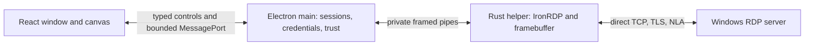

# Standalone RDP client: implementation and remaining roadmap

Status: **Implemented on `feat/rdp`; Apple Silicon live-GUI acceptance is recorded below. The current resize fix awaits a fresh live-server check. Installed cross-platform certification remains pending.** Updated: 2026-10-19.

For operation and developer setup, see [Remote Desktop usage](rdp-client.md).
The exact maintained IronRDP fork, revision, patch inventory, features and Rust
version are pinned in [provenance](../protocol/ironrdp-provenance.json).
The maintained fork is `sliverarmory/IronRDP`, with the embedding patches merged
into its default branch, `master`, based on upstream
`1f69e124e6bf85608efce3495c12eaf5f6b5a95d`. The provenance manifest is the
authority for the current fork commit. Cargo pins that exact revision from
`master` for reproducible builds; experiment/live results retain the revision
they actually exercised.

## Backend decision after R0

V1 uses the native Rust `ironrdp-client` engine and authoritative framebuffer,
with a React canvas viewer inside the sandboxed Electron renderer. It connects
directly over TCP/TLS/NLA and does not require a Sliver server, implant, operator
configuration, cloud account, external RDP installation or Devolutions Gateway.

The [R0 graphics experiment](../native/rdp/experiments/graphics-codec/README.md)
compiled the same pinned IronRDP RDP6 bitmap decoder to native Rust and WASM.
Decoded pixel hashes matched at 1280×800, 1080p and 4K. On the recorded Apple
Silicon host, 4K p95 decode was 12.64 ms native versus 33.27 ms WASM, plus 1.12 ms
p95 to copy WASM output. This is a bounded codec experiment; it does not measure
complete session processing, canvas upload, end-to-end latency or all codecs.

Native decoding is the selected baseline. WASM remains a possible graphics-only
backend, with explicit state/cache recovery and cross-platform parity gates.
There is no production WASM viewer asset in this implementation. The complete
`ironrdp-web` client would retain credentials/session security in the browser;
passing a native authenticated `ConnectionResult` into WASM is not an available
embedding API. Native session/channel processing and graphics share decompression
and cache state, so arbitrary RDP packet forwarding is not a safe extraction seam.
A WASM module that only copies decoded pixels would not improve this architecture.

## Implemented ownership and integration

| Source | Current responsibility |
| --- | --- |
| `src/main/rdp-windows.ts` | Standalone window/session registry, attempt ownership, IPC authorization, input/clipboard focus policy, certificates and helper lifetime |
| `src/main/rdp-runtime.ts` | Fixed helper process, private-pipe framing, bounded event parsing, sanitized errors and shutdown |
| `src/main/rdp-runtime-loader.ts` | Packaged/development helper integrity, source/build provenance and ABI verification |
| `src/main/rdp-store.ts` | Profiles, endpoint certificate pins and separate credential records within an RDP-specific private store; serialized atomic persistence |
| `src/shared/rdp-contracts.ts`, `rdp-validation.ts` | Typed controls, limits, display/input schemas and validation |
| `src/preload/rdp.ts` | Frozen dedicated bridge, validated state, one-use port transfer and context-menu boundary |
| `src/renderer/src/RdpWindowApp.tsx`, `components/rdp/` | HeroUI/Font Awesome forms, profiles, tabs, trust review, desktop canvas, cursor and input capture |
| `native/rdp/` | Rust connection engine, authoritative framebuffer, dirty tiles, custom clipboard backend and offline self-tests |
| `scripts/buildRdpRuntime.mjs`, `verifyRdpRuntime.mjs` | Pinned builds, dependency/license inventory and target/ABI checks |
| `src/e2e/rdp-window.e2e.ts`, `rdp-live.e2e.ts` | Offline standalone-window checks and explicitly configured Windows interoperability |

File → Remote Desktop opens one dedicated window even with no Sliver connection.
It participates in application theme, native menu and window conventions without
registering an operator connection. The dedicated `surface=rdp` document/preload
has sandboxing, context isolation, strict CSP and a separate session partition;
it receives no generic Sliver, filesystem, socket or arbitrary-command bridge.

Main controls connection identity, credential resolution, trust, process lifetime
and attachment permissions. One bundled helper owns each live RDP connection.
It is launched without a shell or PTY, using private pipes and a sanitized
environment. Credentials never appear in argv, environment variables, renderer
URLs or startup files. Helper process separation contains failures; it is not an
OS sandbox claim. The renderer receives pixels, cursor events, bounded metadata
and operation results, and sends typed input/control requests.

## Transport boundary

The shipped transport is **direct TCP only**. Hostname/IP and port are validated
control fields; the renderer does not create or receive sockets. The current
native engine opens the direct connection itself. No `RouteRef`, supplied-stream
connector, Sliver pivot route, RD Gateway or local WebSocket gateway is implemented.

Future supplied networking belongs at a typed main/helper transport boundary.
Add an explicit route descriptor/capability owned by main and a cancellable,
ordered byte-stream dialer in the native fork. Keep logical destination hostname,
certificate identity and credential scope separate from a local forwarding
address. TLS/NLA and RDP state remain in the helper. A new route must have its own
limits, cancellation, ownership and cross-platform tests while preserving direct,
standalone operation. Do not make arbitrary socket bytes or helper commands a
renderer API.

## Display and control protocol

The [native protocol](../native/rdp/protocol.md) and
[shared contracts](../src/shared/rdp-contracts.ts) are authoritative. Main sends
bounded NDJSON commands over the private pipe; helper output uses two little-endian
length fields followed by a JSON header and optional binary payload. Runtime
protocol and build verification precede credential submission. There is no extra
magic-header or feature-bitmap negotiation beyond the implemented contract.

Renderer attachments use random, single-use, expiring capabilities bound to the
owning top-level renderer frame, session and attempt. Each port has exclusive
ownership; replacing it revokes its predecessor. Session/attempt/port identity is
bound by main's closure and ticket, rather than redundantly trusted from every
pixel header. Tiles carry sequence, frame and geometry identifiers, bounds,
`full`/`first`/`last` flags and tightly packed RGBA8 bytes with alpha 255.

| Current policy | Limit |
| --- | --- |
| Open tabs, including disconnected tabs | 4 |
| Saved profiles / remembered certificate endpoints | 100 each |
| Requested desktop dimensions | 200–8192 per axis; at most 16,777,216 pixels |
| Binary frame/cursor payload | 256 KiB |
| Outstanding native display credit | 8 MiB and 128 packets |
| Outstanding renderer cursor delivery | 1 message; latest shape and position retained separately |
| Incoming static/dynamic channel message | 64 MiB before semantic limits |
| Input batch | 64 events |
| Text clipboard | 1 MiB UTF-8 |
| File clipboard | 64 regular files; 256 MiB combined; 256 KiB per chunk |
| Retained received clipboard files | 1 GiB and 1,024 files per app lifetime |
| Attachment grant | 15 seconds, single use |
| Certificate review / startup | 60 seconds / 90 seconds |

The helper consumes every upstream dirty update into its current framebuffer
before coalescing presentation. It never drops stateful RDP data to relieve viewer
backpressure. Full snapshots are tiled; the renderer acknowledges each staged tile
and commits the full image on the final tile. Geometry changes/new snapshots can
supersede incomplete presentation. Invalid lengths, geometry, sequences, credits,
ACKs or attachments fail closed. Buffers cross helper/main/renderer boundaries;
this is not a zero-copy claim or a total-session memory guarantee.

Cursor delivery has separate credit from native framebuffer tiles. Main coalesces
the latest cursor shape/bitmap and latest position independently, sends one cursor
message at a time, and waits for the renderer's typed `cursorAck` after application.
Shape and position alternate when both change, so a stalled viewer retains bounded
cursor state without losing the bitmap when a newer position arrives. Reattachment
replays both components; reconnect clears them. Old-port, repeated and unknown
cursor acknowledgments cannot grant credit to the current attachment.

Input uses physical scan codes for modifiers/shortcuts/navigation and Unicode
for layout-aware text, plus mouse buttons/movement/wheel. Main requires a focused,
visible window, active session and granted capture. The viewer waits for capture
authorization, releases held input on blur/modal/tab change/detach, and reserves
Ctrl+Alt+Escape locally. Toolbar actions send Windows and Ctrl+Alt+Delete keys.
Pre-authentication cleanup does not send active-session input to the helper.

## Authentication, trust and persistence

The pinned fork uses rustls, strict certificate checks, required TLS/NLA and
pre-CredSSP certificate authorization. There is no silent standard-RDP/non-NLA
fallback. The reviewed fork additions include typed certificate-failure reasons,
checks of all certificates (including PKI-valid changed pins), bounded desktop
output and a custom clipboard feature without platform clipboard backends.

Main derives displayed certificate details/fingerprint from DER, binds an expiring
review token to the current challenge/attempt, and permits explicit once/pin
approval only for allowed issuer, validity, name or pin errors. Unknown and
cryptographic failures are not overridable. A rejected, expired, canceled or
replayed review cannot authenticate a different attempt. Pin persistence failure
ends the attempt; a failed/pending pin is not trusted in memory.

Profiles and pins live under the GUI client root in `gui/rdp.json`, separate from
operator/cloud schemas. Profile metadata contains no password; secure credential
envelopes are encrypted by Electron `safeStorage` and resolved only in main.
The file stores profile metadata, encrypted envelopes and pins as separate fields,
not three separate files. Linux `basic_text`/unknown backends cannot enable secure
persistence. Session-only credentials remain in main and are cleared at quit;
`none` does not retain a password for reconnect. Mutations are serialized and
published only after their atomic write succeeds. Failed edits/deletions preserve
the prior credential and metadata. A corrupt or insecure RDP file must disable
RDP without blocking the rest of Sliver GUI or silently replacing trust data;
repair permissions or restore a valid private backup while the app is stopped.

Masked password entry necessarily exists transiently in the connection/reconnect
form; it is cleared promptly and is never returned by the state/profile bridge.
Stored secrets are sent only to the owned helper. Owned byte buffers are cleared,
but neither JavaScript strings nor all upstream credential copies have perfect
zeroization guarantees. Diagnostic output must not retain credentials, clipboard
contents, authentication traffic or desktop payloads.

Pins are scoped to hostname/port independently of profiles. Deleting a profile
removes its credential, not its endpoint pin. A pin-management UI remains future
work. There is no automatic redirect credential reuse or supported redirection
workflow.

## Session and user-visible behavior

- Connection states are connecting, optional certificate review, authenticating,
  active, disconnected or failed. Reconnect is explicit and starts a new attempt;
  no automatic network/authentication retry policy is implemented.
- Disconnect/close-tab ends the connection without logging Windows off. A closed
  tab frees one of the four tab slots. Profiles can launch separate sessions.
- Closing the window preserves live sessions while the application runs. Reopen
  File → Remote Desktop and use Reattach viewer when requested. Reload/crash
  revokes the old port and restores a full snapshot without reauthentication.
  Pending certificate review is canceled when its viewer closes.
- Application quit terminates helpers and clears session-only secrets. Sliver
  operator disconnect/reconnect does not affect direct RDP sessions.
- Fit/Actual size scale the local presentation. These toolbar choices and the
  automatic-resize toggle are session/window preferences, not persisted profile
  edits. Dynamic resize requests are validated, debounced and deduplicated across
  viewer reattachment and server reactivation. EGFX framebuffer changes complete
  a resize without requiring classic Deactivate All. If the server cannot resize
  live, automatic resize reconnection is disabled in the embedded engine; the
  connection stops and the requested dimensions are retained for explicit reconnect;
  the active canvas retains its existing geometry until actual frames change.
- Clipboard is enabled by default for new connections. Changing its switch
  persists the new-connection preference immediately through the existing
  revisioned application settings store (`gui/application-settings.json`), even
  when the dialog is canceled. Saved profiles retain their explicit choice.
  Text and files transfer through the toolbar's Send/Receive actions by default.
  **Configuration → Transparent clipboard** opts into automatic bidirectional
  clipboard synchronization for the focused active RDP tab with an attached viewer.
  This preference is persisted separately and defaults to false, including for
  existing settings. Main polls for local clipboard changes and consumes fresh
  remote clipboard announcements; received content is tracked to avoid sending it
  back. Files take priority over text when both formats are available.
  Receiving waits for the actual server reply and local clipboard write. A ready
  channel permits sending before remote content exists; receiving additionally
  needs an advertised text or file format. Blur/tab/attempt changes cancel a
  pending receive. Sending local content clears remote availability until a fresh
  remote copy is advertised. Clipboard failures reject the operation without
  ending RDP. For text, the helper permits one outstanding wire request and drains
  stale ownership replies before accepting another, since CLIPRDR format-data
  replies do not carry request IDs.
- File clipboard uses CLIPRDR file descriptors and bounded file-content requests.
  Main owns local file access and temporary storage; paths and file bytes never
  enter the renderer. Only regular files are supported, with at most 64 files and
  256 MiB combined, transferred in chunks of at most 256 KiB. Folders and symbolic
  links are rejected. Received files are staged in a private temporary directory
  before native local file clipboard formats are written; staging lasts until
  the app quits so files remain available for local paste. Completed staging is
  bounded to 1 GiB and 1,024 files across copies; another receive fails before
  publication if it would exceed either total. App shutdown awaits cleanup of
  staged files and in-flight transfers. File clipboard does
  not enable drive redirection. Native file-manager interoperability on macOS,
  Windows and Linux and live Windows file round-trips remain acceptance work;
  previous Unicode text clipboard evidence does not establish file transfer.

## Platforms, packaging and evidence

| Execution target | Rust target | Package family |
| --- | --- | --- |
| macOS arm64 | `aarch64-apple-darwin` | Universal DMG/ZIP |
| macOS Intel | `x86_64-apple-darwin` | Same universal DMG/ZIP |
| Windows x64 | `x86_64-pc-windows-msvc` | NSIS and portable EXE |
| Linux x64 | `x86_64-unknown-linux-gnu` | AppImage and DEB |

The pinned build uses Rust 1.94.1, `rustls` and `clipboard-custom`, macOS deployment
target 13.0, Linux glibc baseline 2.35 and static MSVC CRT. Packaging places the
helper, provenance and license inventory outside ASAR under `resources/rdp/`.
The internal build record lives at `native/rdp/packaged-provenance.json` inside
ASAR, outside the source directory copied by Electron Builder's `extraResources`.
Its bytes must match the external helper provenance before runtime verification.
Runtime loading checks the expected architecture, protocol and artifact identity;
release signing/content verification includes nested helper code. App/helper
updates are delivered together. There is no independent helper download channel.

The [platform ADR](adr/0001-platform-support.md) specifies macOS 13.7.8 on both
native architectures, Windows 11 24H2 x64 and Ubuntu 22.04.5/glibc 2.35/X11 x64.
It records the current Electron 44.5.1 baseline. Installed-package certification
still needs refreshing; build success, Rosetta or a newer host does not certify
those minimum runtimes. Windows/Linux ARM64 are not targets.

Evidence at this checkpoint:

- R0 native/WASM codec equality and measurements are recorded in the experiment.
- Both macOS helper slices build; universal provenance/ABI/offline checks and the
  real Electron ASAR-loader probe have passed on the developer host.
- Helper-level Windows Server 2019 NLA, desktop, scan-code/Unicode input and
  clipboard negotiation have been exercised from Apple Silicon.
- **Final live GUI PASS at 2026-10-20T02:08:43.278Z:** macOS 27.0.1 arm64,
  Electron 44.5.1, Windows Server 2019 (CASTLEBLACK), 1280×800. The scenario
  verified NLA, rendering, Windows-R → Notepad, keyboard text copied back from
  Windows, Unicode clipboard local → remote → local, renderer reload retaining
  session ID/attempt, and explicit disconnect. The screenshot was inspected.
  Local ignored evidence: `artifacts/e2e/rdp-live-desktop.png` and
  `artifacts/e2e/rdp-live-result.json`.
- This final run used fork `1835457f27045d0098a4861b7b50204539539ec6`, universal
  helper SHA-256 `67360927081daaef040a0908d9cd6a190d70313919fc8bf3734a894660f807eb`,
  and build identity `ef95464090dc47197b57557b141270e2fae7d2abddf715b405e394a5947b7abd`.
  The helper includes the clipboard ownership/late-reply fix; the renderer uses
  bounded cursor acknowledgments as well as frame credits.
- The resize-loop fix pins fork `bfa5a8966fce80d659765c018895036ec775a012`.
  Its 22 selected-feature client tests passed, alongside 89 focused GUI tests,
  14 helper tests, 15 build/provenance tests and two offline Electron scenarios.
  The Apple Silicon helper rebuild, provenance/ABI/self-test and GUI
  typecheck/build passed. No live RDP configuration was available for this
  checkpoint, so these results do not establish live resize interoperability.
- The full unit checkpoint passed 5,203 tests with three skips. Subsequent
  runtime, store, loader and packaging changes passed 73 focused tests.
  Native helper tests passed 14; packaging/signing checks passed 65 with one
  platform skip. Fresh typechecks/build and all eight preload checks passed.
- Offline RDP Electron tests passed 2/2, including malformed settings recovery.
  The broader Electron suite completed with 46 passes, one BOF synchronization
  assertion failure and one Windows-only skip. That unchanged BOF case passed
  its isolated rerun; the initial failure remains recorded in
  `artifacts/e2e/rdp-regression-suite.log` and `rdp-bof-rerun.log`.
- Protocol/client provenance and parity passed against the exact pinned Sliver
  source: 269 static nodes and 269 reviewed annotations. Platform CI must
  independently verify the committed source; local proof does not replace it.
- Native Intel minimum-OS, Windows and Linux installed/live acceptance is pending.

## Remaining roadmap and release gates

Implementation status is separate from acceptance status; the original proposal's
statement that every milestone was unimplemented no longer applies.

| Milestone | Current implementation | Remaining acceptance/work |
| --- | --- | --- |
| R0: architecture proof | Native helper/canvas path, strict TLS/NLA, fork hooks, clipboard split and bounded WASM codec comparison implemented; native selected | Broader codec/reset coverage, complete IPC-to-canvas and memory measurements on each target |
| R1: standalone vertical slice | Offline File menu/window, direct form, trust review, explicit disconnect and isolated bridge implemented | Bad-credential/cancel/startup-failure smoke on installed packages |
| R2: integrated client | Profiles, credential choices, tabs/rename, theme, fit/fullscreen/resize, input and manual/automatic text and file clipboard implemented | File clipboard live round-trips and native file-manager interoperability; local/domain account policies; cross-platform modifiers/IME/AltGr/high-DPI; multi-tab isolation; pin-management and persisted scale UX follow-ups |
| R3: lifecycle/performance | Attempts/ports/credits, framebuffer snapshots, viewer recovery, helper failure isolation and explicit reconnect implemented | Sustained screen-load/idle soak, suspended/stalled viewer tests, sleep/wake and network loss; define measured latency/memory thresholds; optional retry policy remains future work |
| R4: release matrix | Four target build/signing/provenance/content-check lanes configured; platform ADR updated | Native installed and live acceptance on all supported targets/package forms, update with an active session, exact immutable artifact/log evidence. This is the shipping gate. |
| R5: optional WASM graphics | Codec experiment only; production extraction deferred | Extract after shared session decompression/channel processing; preserve caches/fragments/surfaces/ACKs; golden pixels, resize/reactivation and lost-worker recovery; comparative performance on every target |
| R6: additional capabilities | Deferred | Typed supplied transports first as needed; separately scope Kerberos/SSO, RD Gateway, UDP, multi-monitor, audio/microphone, RemoteApp, drive/printer/device/smart-card redirection, `.rdp` import and advanced codecs |

A future WASM worker must be local and integrity checked, own a precisely defined
graphics state, and keep credentials/TLS/NLA/native channel authority outside the
renderer. Preserve CSP; do not assume SharedArrayBuffer or cross-origin isolation.
Worker loss needs proven complete state resynchronization or an explicit reconnect
to native. H.264/WebCodecs and blanket upstream feature parity are not v1 claims.

Release results must identify GUI/fork revisions, helper/viewer digests, toolchain,
exact client OS/CPU, Windows server/policy, package, test identifiers and terminal
results. A failed/unexecuted target prevents claiming full GUI-matrix acceptance.

## Source references

- [Pinned upstream browser client](https://github.com/Devolutions/IronRDP/blob/1f69e124e6bf85608efce3495c12eaf5f6b5a95d/crates/ironrdp-web/README.md)
  and its [session/authentication implementation](https://github.com/Devolutions/IronRDP/blob/1f69e124e6bf85608efce3495c12eaf5f6b5a95d/crates/ironrdp-web/src/session.rs).
- [Pinned native client implementation](https://github.com/Devolutions/IronRDP/blob/1f69e124e6bf85608efce3495c12eaf5f6b5a95d/crates/ironrdp-client/src/rdp.rs).
- [Maintained embedding patch inventory](https://github.com/sliverarmory/IronRDP/blob/master/SLIVER_GUI_EMBEDDING.md);
  the local provenance manifest pins its exact commit and content hash.
